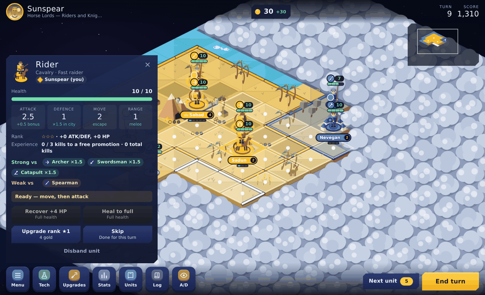
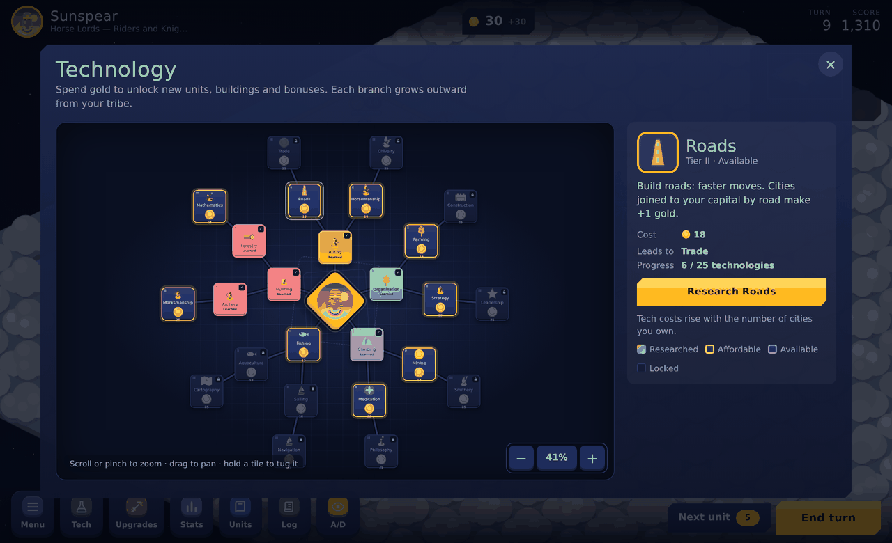
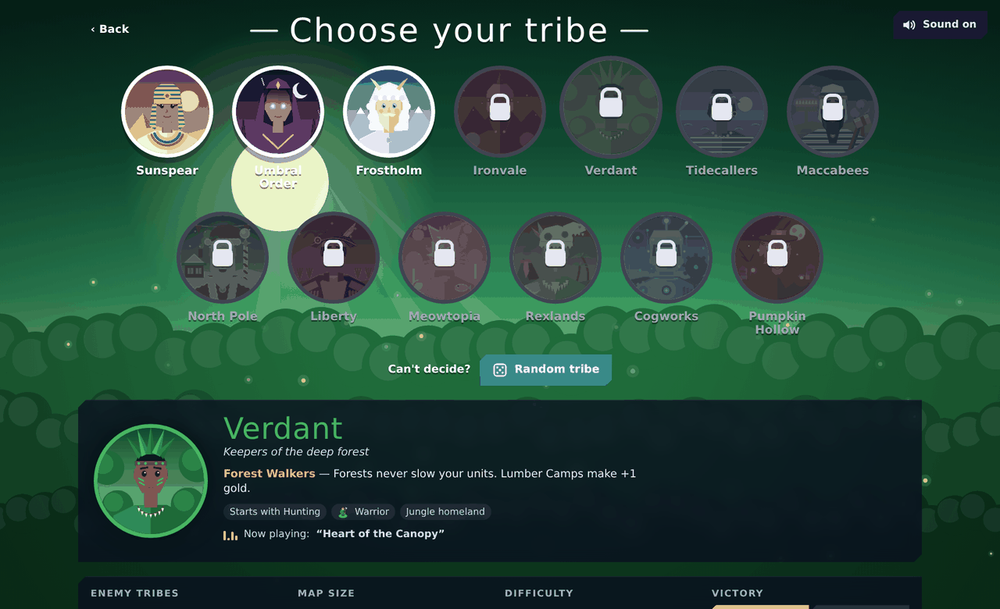
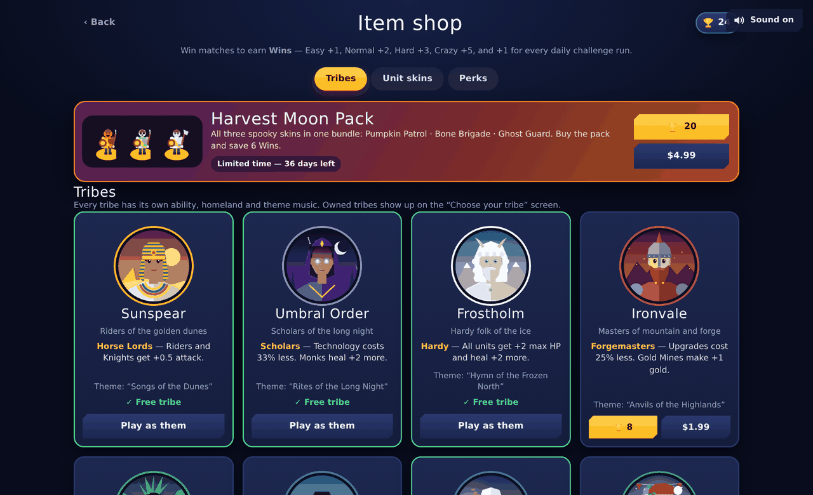
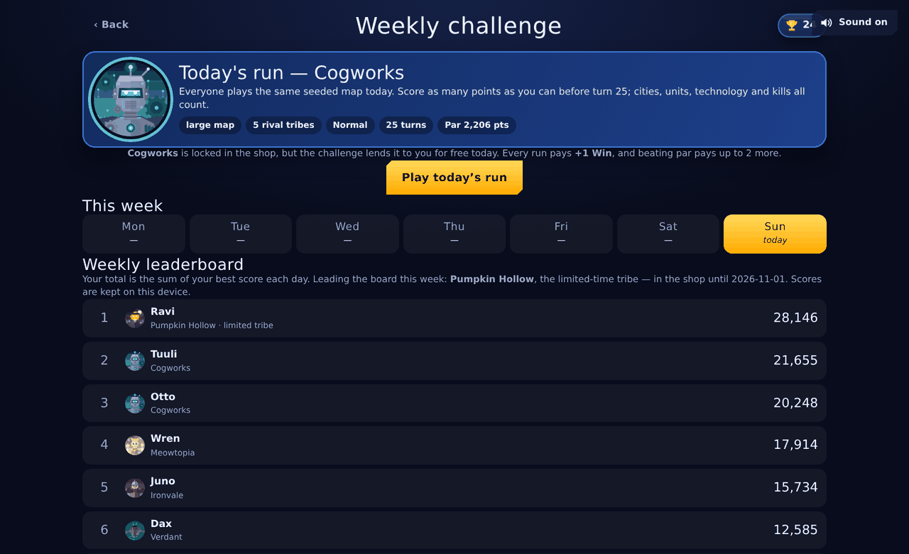

# Tessera Tribes

A turn-based 4X strategy game that runs entirely in the browser — one self-contained HTML file, no build step needed to play, no server, no dependencies. Explore a tiled world, grow cities, research technology and conquer every rival tribe.

Inspired by Polytopia and Age of Empires, with rock-paper-scissors unit counters, a zoomable technology tree, thirteen playable tribes (each with its own ability, homeland and procedurally generated theme music) and a daily challenge.



## Play it

**In your browser: [3ebby15-dev.github.io/tessera-tribes](https://3ebby15-dev.github.io/tessera-tribes/)** — served straight from this repo by GitHub Pages.

Or open `index.html` from a local clone; it is the entire game, art, music and all, in one file:

```bash
git clone https://github.com/3ebby15-dev/tessera-tribes.git
cd tessera-tribes
open index.html        # macOS  (Linux: xdg-open index.html)
```

Works with mouse, keyboard or touch. Everything is saved in `localStorage`, so your game, your Wins and your shop unlocks stay on the device and browser you played on.

### Turning Pages on (once per fork)

1. **Settings → Pages**
2. **Source:** Deploy from a branch
3. **Branch:** `main`, folder `/ (root)` → **Save**

A minute later the game is live at `https://<your-username>.github.io/tessera-tribes/`. `index.html` is committed, so nothing has to build on GitHub's side — after changing anything in `src/`, run `./build.sh` and commit the regenerated `index.html`.

## What's in it

**The world** — an isometric tiled map (12, 18 or 26 tiles across) generated fresh each game, with fields, forests, mountains, shallow water and deep ocean, plus wild crops, berries, game, gold ore and fish. Water rolls with waves, fish swim, plants lean in the wind and unexplored land sits under a cloud layer you can poke.

**Units and counters** — ten unit types across infantry, cavalry, siege and legends. Every unit is strong against something and weak against something else: spearmen stop cavalry, cavalry runs down archers, swordsmen and catapults, swordsmen beat every foot unit, archers shred spearmen. A strong matchup multiplies attack *and* defence by ×1.5; the swordsman is halved against cavalry. Hover an enemy for an exact damage forecast before you commit.

**Economy** — one currency, gold. Cities produce it every turn, and farms, lumber camps, gold mines and fisheries add more. Gold trains units, researches technology, buys army-wide upgrades and promotes individual units.

**Technology** — 25 technologies in five branches on a zoomable, pannable board. Scroll or pinch to zoom, drag to pan, and hold a tile to tug it around on a spring. Unlocking one charges the branch line, flips the tile and throws confetti.



**Tribes** — thirteen of them, each with a unique ability, a homeland biome, a hand-drawn chief portrait and its own procedurally synthesised theme music (Web Audio, no audio files):

| Tribe | Ability |
| --- | --- |
| Sunspear | Horse Lords — riders and knights get +0.5 attack |
| Umbral Order | Scholars — technology costs 33% less |
| Frostholm | Hardy — every unit gets +2 max HP and heals +2 more |
| Ironvale | Forgemasters — upgrades cost 25% less, gold mines make +1 |
| Verdant | Forest Walkers — forests never slow you, lumber camps make +1 |
| Tidecallers | Seafarers — sail shallow water from turn 1 |
| Maccabees | The Hammer — foot units hit harder, defenders hold your borders |
| North Pole | Gift Workshop — every city makes +1 gold each turn |
| Liberty | Frontier Spirit — see 1 tile further, +6 gold per capture |
| Meowtopia | Nine Lives — once a round, a dying unit survives on 1 HP |
| Rexlands | Stampede — raptor cavalry moves 1 extra tile with +3 HP |
| Cogworks | Self-Repair — every unit repairs 2 HP each turn |
| Pumpkin Hollow | Trick or Treat — every kill drops +3 gold (limited time) |



**Progression** — winning matches earns **Wins** (Easy +1, Normal +2, Hard +3, Crazy +5). Spend them in the item shop on tribes, army-wide cosmetic skins and match perks.



**Weekly challenge** — one seeded run a day. Everyone gets the same map, rivals and tribe; you have 25 turns to score as many points as you can, with a par target, a week strip of your daily bests and a leaderboard.



## Controls

| Input | Action |
| --- | --- |
| Click / tap | Select a unit, city or tile · click a highlighted tile to move, a red one to attack |
| `N` | Next unit that can still act |
| `Enter` | End turn |
| `Esc` | Clear selection / close a panel |
| `V` | Show attack and defence values on the map |
| Drag | Pan the map · scroll or pinch to zoom |
| `+` `-` `0` | Zoom in, out and fit (in the technology tree) |

## Building from source

The game ships as a single HTML file assembled from the parts in `src/`:

```bash
./build.sh          # writes index.html (and dist/ copies)
```

`index.html` at the repository root is the standalone page — what GitHub Pages serves and what you open locally. `dist/tessera.html` is the same game without the page skeleton, for hosts that supply their own, and `dist/test.html` is the copy the headless tests load. Only `index.html` is committed; `dist/` is ignored.

### Project layout

| Path | What lives there |
| --- | --- |
| `src/00_head.html` | Markup and all CSS |
| `src/01_data.js` | Tribes, biomes, units, counters, technologies, upgrades, skins, perks, difficulty |
| `src/02_core.js` | Map generation, new game setup, tile helpers |
| `src/03_rules_a.js`, `src/03_rules_b.js` | Unit stats, combat, actions, economy, research, scoring |
| `src/04_ai.js` | Opponent AI |
| `src/05_render_terrain.js` | Isometric terrain, cached layer, live wind/water/fish layer |
| `src/06_render_units.js` | Unit figures, skins, badges, health bars, effects, minimap |
| `src/07_ui_panels.js` | Top bar, selection panel, tooltips |
| `src/08_ui_flow.js` | Turn flow, input, modals, toasts |
| `src/09_ui_screens.js` | Overlays, game menu, save/load, boot |
| `src/10_audio.js` | Web Audio synth engine, sound effects, music sequencer |
| `src/11_menu_fx.js` | Menu effects, sound button, loading screen |
| `src/12_tribe_music.js`, `src/16_tribe_music2.js` | One theme per tribe, plus a calmer in-match variant |
| `src/13_tribe_art.js`, `src/17_tribe_art2.js` | Chief portraits and animated homeland scenes |
| `src/14_pick.js` | Tribe picker screen |
| `src/15_techtree.js` | Technology tree board |
| `src/18_profile.js` | Wins currency, ownership, equipped skin and perks |
| `src/19_shop.js` | Item shop |
| `src/20_challenge.js` | Weekly challenge and leaderboard |

Parts are concatenated in the order listed in `build.sh` (note that `09_ui_screens.js` goes last — it holds the boot code).

### Tests

Browser tests drive the real build in headless Chromium with [Playwright](https://playwright.dev/):

```bash
npm install -g playwright && playwright install chromium
node test/browser_long.js medium 4 40      # plays a full game, reports engine errors
node test/browser_tt2.js /tmp              # technology tree: zoom, drag, unlock animations
node test/shot.js /tmp                     # screenshots of the menu and a live game
```

Headless balance simulations run the engine in Node with no DOM:

```bash
./test/mk_sim.sh                            # assembles the harnesses from src/
node test/run_diff.js easy,normal,hard,crazy 16 90 small   # difficulty curve
node test/run_bal2.js 30                    # per-tribe win rates
```

## Notes

- No backend, no build step on the server — GitHub Pages just serves the file. Saves, Wins, shop unlocks and challenge scores live in `localStorage`; the challenge leaderboard is generated locally from the week's seed.
- USD prices in the shop are display-only — no payment processing is wired up, so those buttons explain that and offer the Wins price instead.
- All art is drawn with the Canvas 2D API at runtime and all music is synthesised with the Web Audio API. The only external asset is two Google Fonts stylesheets, and the game falls back to system fonts without them.
